# Lab 3: REST API, Query Parameters, Validation and Debugging

## 1. Project Overview

This project demonstrates the development of a RESTful API using Node.js, Express.js and SQLite. It provides book management operations such as retrieving, searching, filtering, adding, updating and deleting books.

## 2. Objectives

- Develop REST API endpoints using Express.js.
- Implement query parameters for searching, sorting and pagination.
- Apply price range filtering.
- Validate incoming request data.
- Handle errors using appropriate HTTP status codes.
- Test API endpoints using Postman.
- Integrate SQLite as the database.

## 3. Technologies Used

- Node.js
- Express.js
- SQLite
- JavaScript
- Postman
- Visual Studio Code

## 4. Project Structure

```text
lab-03/
├── screenshots/
├── node_modules/
├── .gitignore
├── books.db
├── database.js
├── index.js
├── package-lock.json
├── package.json
└── README.md
```

Note: The `node_modules` folder is excluded from GitHub using `.gitignore`.

## 5. Installation and Execution

### Step 1: Install dependencies

```bash
npm install
```

### Step 2: Start the application

```bash
npm start
```

### Step 3: Access the API

```text
http://localhost:3000
```

The SQLite database and books table are created when the application starts.

## 6. API Endpoints

| Method | Endpoint | Description |
|---|---|---|
| GET | `/books` | Retrieve books with search, sorting, filtering and pagination |
| GET | `/books/:id` | Retrieve a book using its ID |
| POST | `/books` | Add a new book |
| PUT | `/books/:id` | Update an existing book |
| DELETE | `/books/:id` | Delete a book using its ID |

## 7. Query Parameters

The GET `/books` endpoint supports:

- `search_q` – Search books using partial title matching.
- `order_by` – Select the field used for sorting.
- `order` – Choose ascending or descending order.
- `limit` – Specify the maximum number of records.
- `offset` – Skip a specified number of records.
- `min_price` – Filter books using a minimum price.
- `max_price` – Filter books using a maximum price.

## 8. Request Validation and Error Handling

The POST endpoint validates the incoming request body.

- Title and author are required.
- Price must be numeric.
- Invalid input returns HTTP 400 with an error message.
- Successful creation returns HTTP 201.
- Successful retrieval, update and deletion return HTTP 200.
- A missing book returns HTTP 404.

## 9. Postman Screenshots

The following screenshots demonstrate the API testing process.

### Basic API Testing

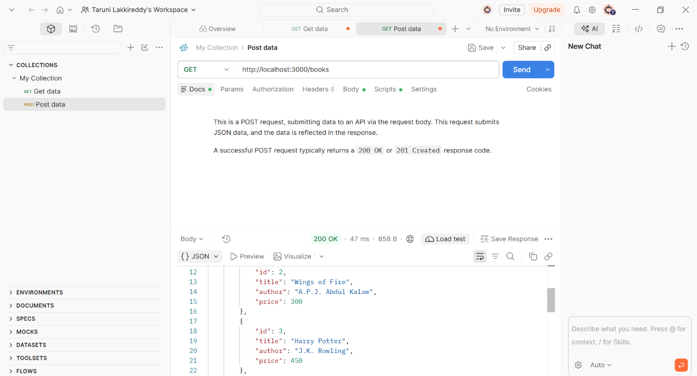

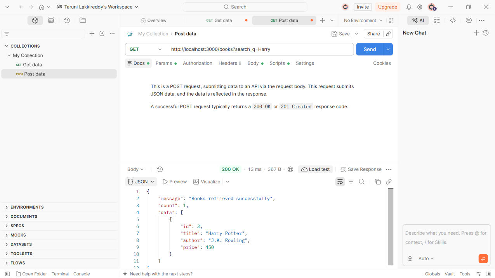

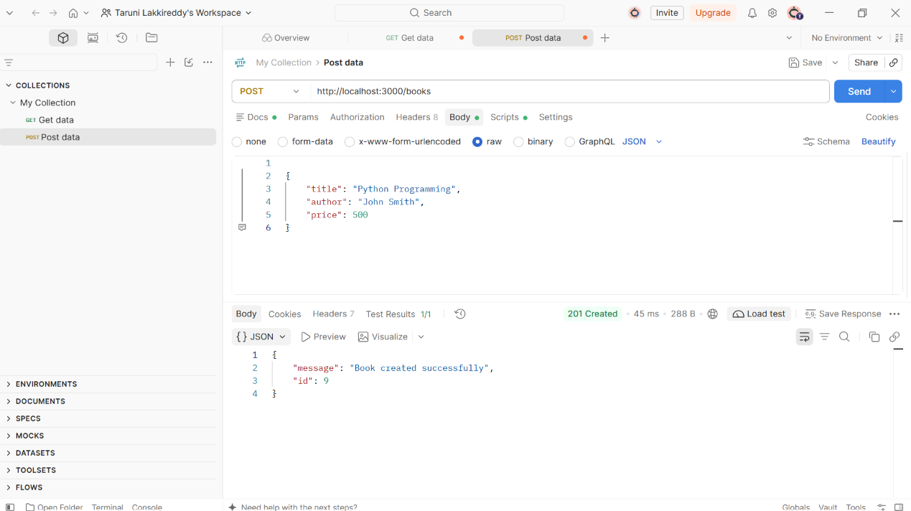

### API Operations

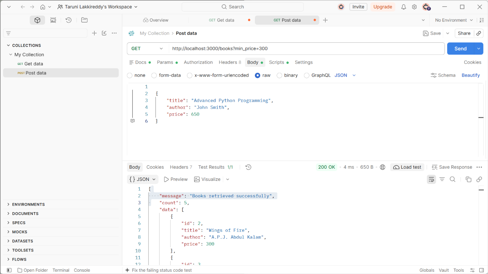

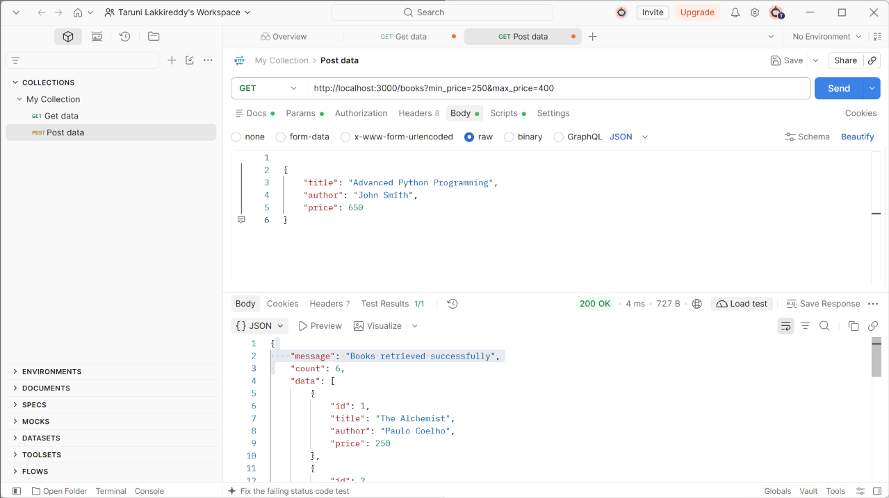

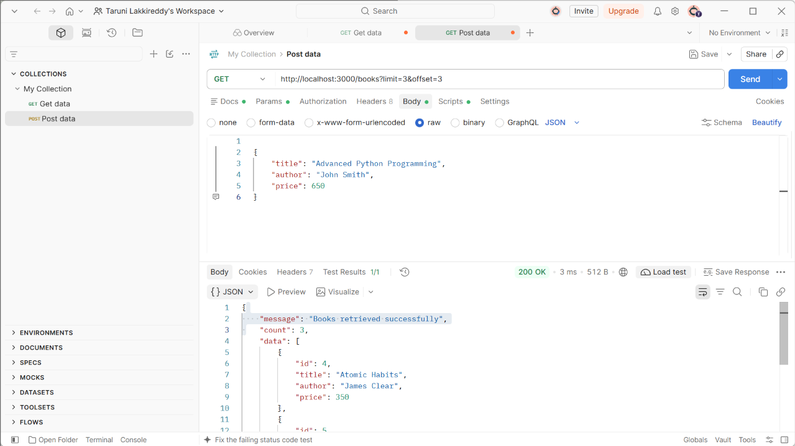

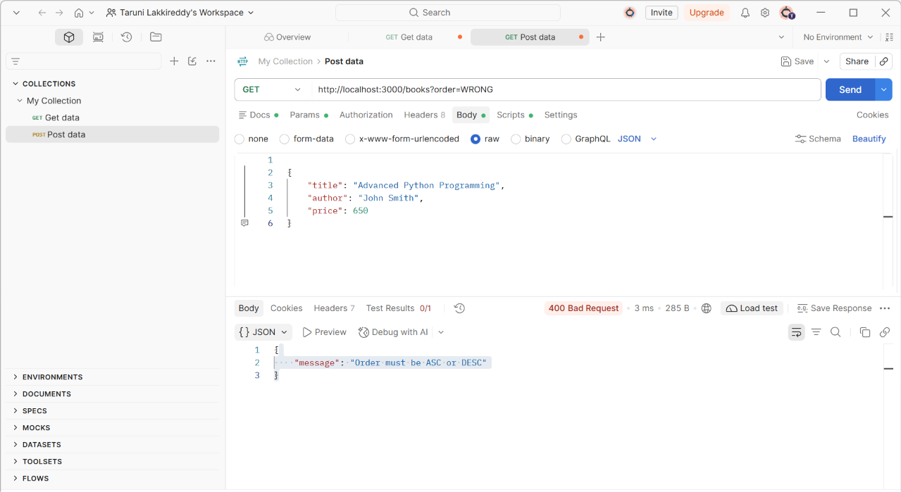

### Request Validation

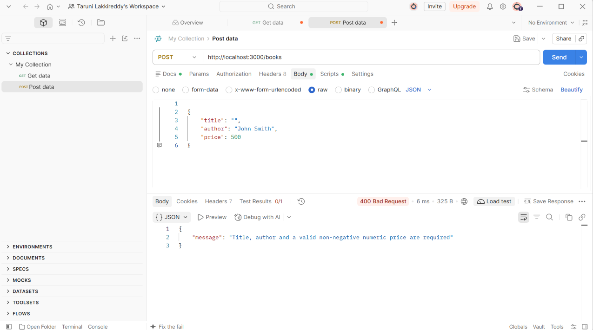

### GET and Update Operations

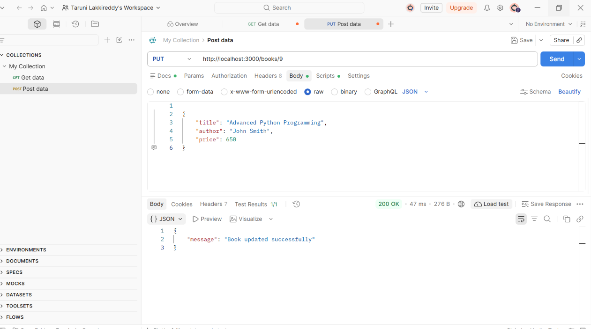

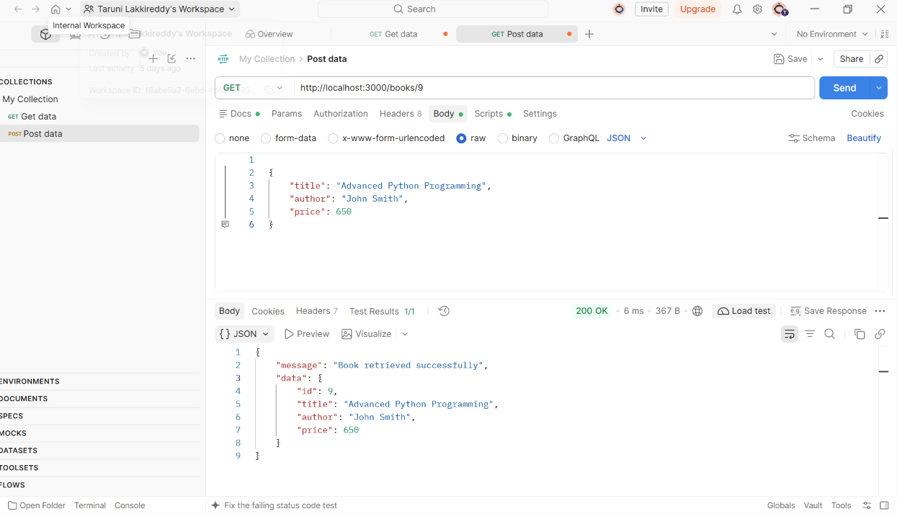

### Delete and Not Found Operations

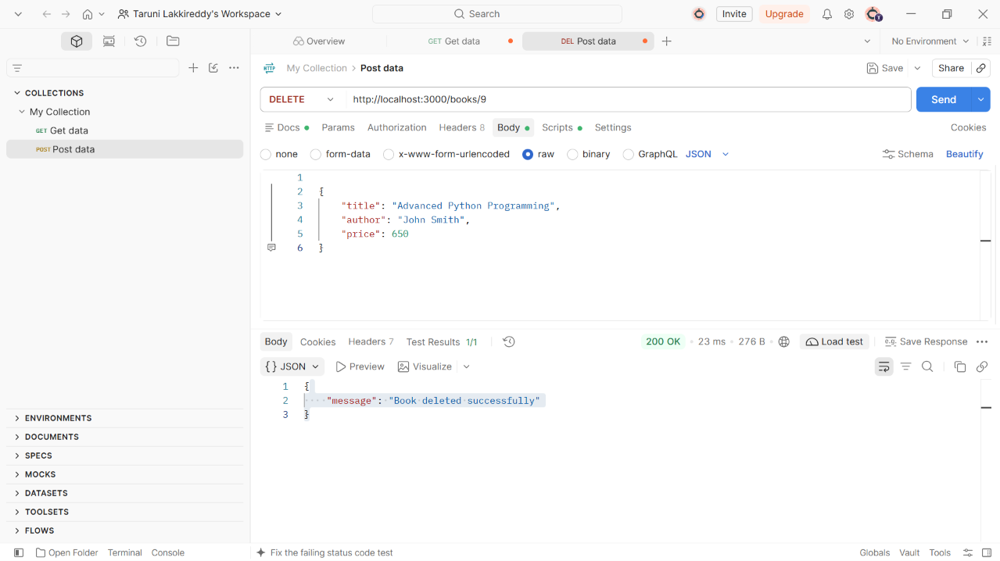


### Sorting Operations

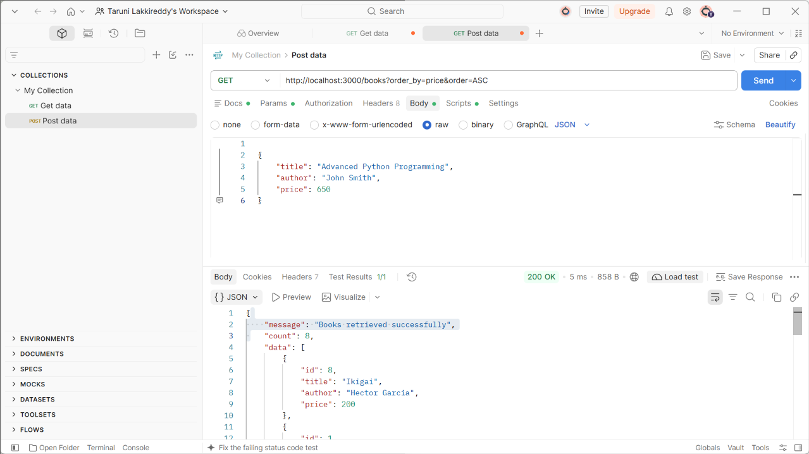

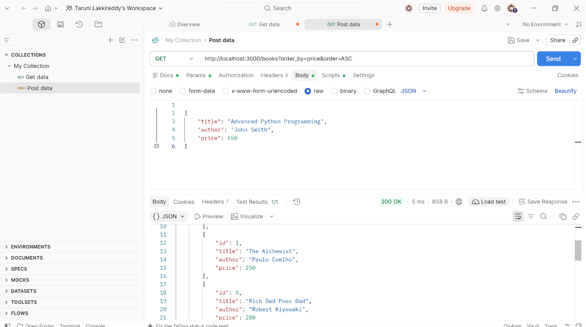

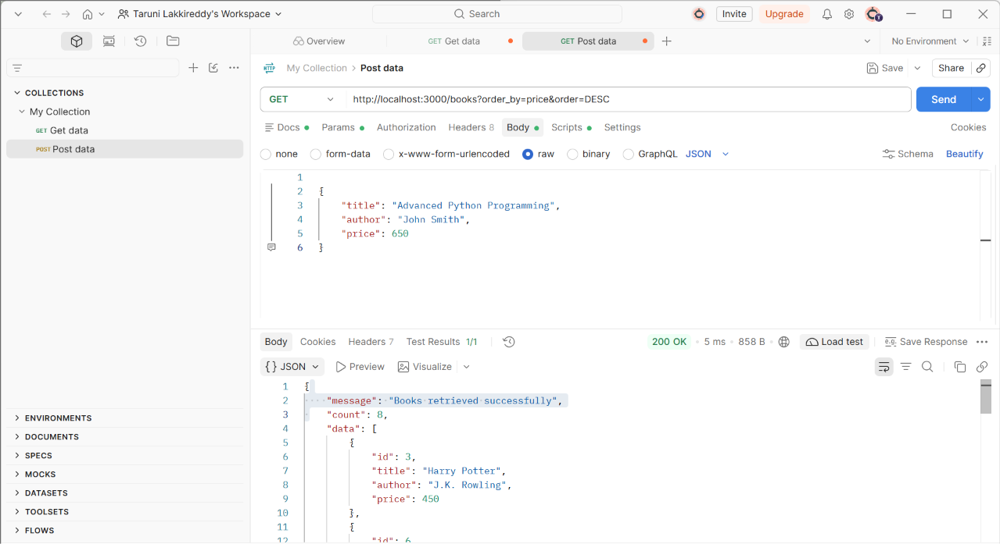

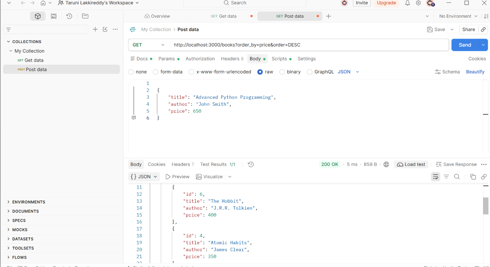

## 10. Conclusion

This lab provided practical experience in developing and testing RESTful APIs using Node.js, Express.js and SQLite. It helped demonstrate CRUD operations, query parameters, request validation, error handling and HTTP status codes. Postman was used to test the API endpoints and verify their responses.